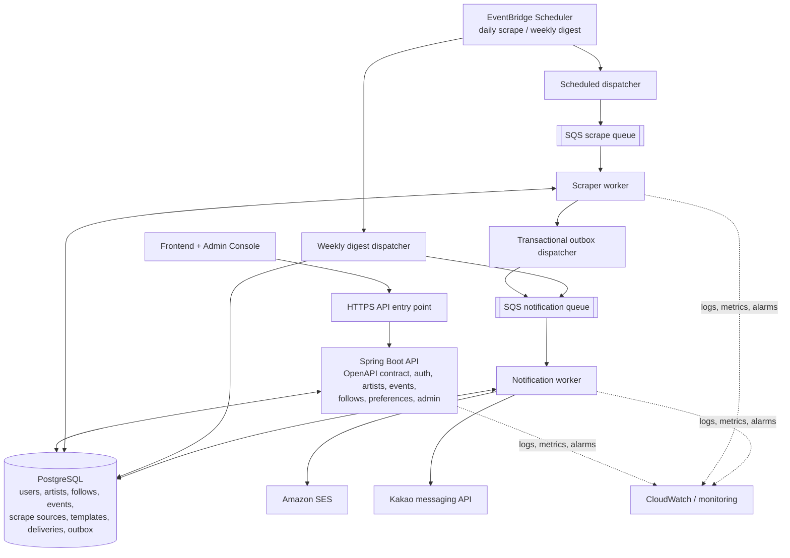

# Artist & Concert Event Management Hub — Architecture Summary

## 1. Architecture goals

- Implement the frontend-facing API contract defined in `openapi(3).yaml`.
- Send personalized weekly email/Kakao digests based on user preferences and admin-managed templates.
- Scrape configured artist websites daily and detect new events.
- Notify followers promptly after a new event is discovered.
- Let admins manage artists, scrape source URLs, scraping strategies, and message templates without database schema migrations.
- Keep background processing resilient to transient failures and provider outages.
- Minimize cloud costs initially while retaining a path to production scaling.

## 2. Recommended logical architecture

The diagram is logical: deploy the API and workers independently so they can scale and fail independently.

## 3. Application and worker stack

### API

- **Java + Spring Boot MVC** for the REST API.
- **Spring Security** for OAuth integration and authorization, including server-side admin role enforcement.
- **Spring Data JPA + Flyway** for relational persistence and schema migrations.
- Use the supplied OpenAPI document as the API contract; complete missing request/response schemas, errors, pagination, and admin endpoints before implementation.
- Avoid introducing PHP/Phalcon or WebFlux unless a specific requirement justifies them.

### Background workers

Use **Java lightweight Lambda handlers as the initial default**, rather than deploying a full Spring Boot application with Spring Batch for every job.

- **Scraper worker:** process a bounded unit of work, such as one configured website/source per job.
- **Notification worker:** process delivery jobs from SQS, check eligibility, render the correct template, send through a provider adapter, and persist delivery status.
- **Weekly digest:** dispatch work in user batches. Add Spring Batch if the workload needs persistent checkpoints, chunk processing, restartable multi-step jobs, or job execution metadata.
- Worker language is not irrevocably decided: Java is the simplest starting point for sharing domain logic with the API; Go or Python are valid alternatives if their concurrency or scraping libraries materially help.
- Keep jobs bounded and resumable. A Lambda invocation has a maximum execution time, so do not process an unbounded scrape or an entire large campaign in one invocation.

## 4. Event discovery and notification flow

1. EventBridge Scheduler starts the daily scrape workflow.
2. A dispatcher reads active scrape source configurations and publishes individual jobs to SQS.
3. Scraper workers fetch and parse websites using the configured strategy.
4. Normalize and validate discovered events.
5. Deduplicate events using a stable source event ID where possible, or a carefully designed fallback identity enforced by a database unique constraint.
6. In one database transaction, persist the new event and an outbox record.
7. An outbox dispatcher publishes notification events to SQS, retrying publication when necessary.
8. Notification workers resolve artist followers and current user preferences, create idempotent delivery records, and send email/Kakao messages.
9. Record provider outcomes and retry transient failures; send repeatedly failing messages to a dead-letter queue (DLQ).

“Immediate notification” means promptly after the daily scraper discovers a new event. Daily polling can still leave up to roughly a day between a website update and detection.

## 5. Weekly digest flow

1. EventBridge Scheduler triggers the weekly digest workflow.
2. Create a persistent digest-run record for the period.
3. Query eligible users in bounded pages/batches.
4. Resolve preferences, followed artists, and relevant events.
5. Render the admin-managed, versioned template for the selected locale/channel.
6. Create unique delivery records and enqueue delivery jobs.
7. Workers send messages and record outcomes.
8. Resume failed/incomplete runs without creating duplicate deliveries.

Do not load every user or generate an entire campaign in one invocation.

## 6. Admin-managed artists and scraping sources

Separate data changes from schema migrations:

- **Flyway migrations:** database schema changes only.
- **Artist management:** normal admin CRUD operations.
- **Scrape source management:** versioned database configuration, including artist, URL, strategy type, parsing rules, active version, and operational limits.
- Provide test/preview, validation, activation, and rollback of source configuration.
- Prefer predefined strategies such as structured APIs/JSON, JSON-LD, and CSS selectors over arbitrary admin-uploaded executable code.
- Protect against SSRF: block private/link-local/loopback destinations, validate redirects and resolved addresses, use timeouts and response-size limits, and apply per-host rate limits.

## 7. Core data model

Recommended relational tables:

- `users`
- `user_notification_preferences`
- `artists`
- `artist_follows`
- `events`
- `scrape_sources` (versioned configuration)
- `scrape_runs`
- `notification_templates` (versioned)
- `digest_runs`
- `notification_deliveries`
- `outbox_events`

Useful constraints and indexes include:

- Unique event identity per source or normalized event identity.
- Unique delivery identity, e.g. `(event_id, user_id, channel, notification_type)` for event alerts, adapted for digest periods.
- Index follows by `artist_id`; events by artist/date; pending deliveries by status/creation time.
- Keep user preference state separate from delivery status.

## 8. OpenAPI items to resolve

The provided OpenAPI covers login, artist/event reads, user profile, follows, notification preferences, and onboarding. Before implementation:

- Add admin APIs for artist management, scrape sources/strategy versions, templates, and operational run/delivery inspection.
- Include an explicit artist relationship (`artistId` or equivalent) in event data where required.
- Define full auth/token/session behavior and server-enforced admin authorization.
- Expand notification preferences to clearly represent channel opt-ins, per-notification-type settings, locale, and consent/unsubscribe state as required.
- Standardize pagination and error response schemas.
- Fix the path mismatch: `DELETE /users/me/followed-artists` currently declares an `artistId` path parameter without `{artistId}` in the URL. Prefer `DELETE /users/me/followed-artists/{artistId}` or define the ID as a query parameter.

## 9. Cost-conscious cloud deployment

### Initial low-cost option

- **API:** Spring Boot packaged for AWS Lambda using Lambda Web Adapter, fronted by an appropriate HTTPS/API entry point.
- **Database:** Neon PostgreSQL free tier initially, if its limits and availability are acceptable for the current stage.
- **Scheduling:** Amazon EventBridge Scheduler.
- **Asynchronous jobs:** Amazon SQS with dead-letter queues.
- **Workers:** AWS Lambda for bounded dispatcher, scraper, and notification tasks.
- **Email:** Amazon SES.
- **Logs/alarms:** basic Amazon CloudWatch configuration.
- **Frontend:** static or low-cost frontend hosting.
- **S3:** optional for scrape snapshots/archive data; omit until needed.

This reduces idle compute and managed-database costs compared with always-on ECS/Fargate and RDS/Aurora, but introduces free-tier limits, cold starts, external database dependency, and connection-management considerations. Verify current provider pricing and quotas before deployment.

### Scale-up path

Move to managed RDS/Aurora and/or ECS Fargate if workload, uptime, recovery, networking, connection limits, or operational requirements justify the expense. Add ElastiCache, OpenSearch, CloudFront, Prometheus/Grafana, or Bedrock only when a measured requirement supports them.

Avoid scheduling a public API to be available only from 09:00–18:00 unless downtime outside those hours is an explicit product requirement. Serverless execution is a better default for variable traffic.

## 10. Reliability and security checklist

- SQS retries, DLQs, visibility timeouts, and alarms on queue age/depth.
- Idempotent consumers; assume messages may be delivered more than once.
- Transactional outbox to avoid losing events between database commit and queue publication.
- Database connection pooling and strict connection limits, especially with Lambda concurrency.
- Provider-specific rate limits, transient-error retries with exponential backoff/jitter, and delivery audit history.
- Respect current user preferences and opt-outs at send time.
- Least-privilege IAM, managed secrets, encryption, and admin audit logs.
- Scraper timeouts, bounded response sizes, domain throttling, and parser-health monitoring.
- Structured logs and correlated scrape/digest/delivery run IDs.
- Test retries, duplicate messages, partial failures, queue redrive, worker restarts, and database backup/restore.

## 11. Implementation order

1. Finalize the OpenAPI contract and relational model.
2. Implement the Spring Boot API, authentication/authorization, and core artist/event/follow/preference endpoints.
3. Add admin-managed scrape sources and a deterministic scraping pipeline.
4. Add SQS, outbox publication, idempotent notification delivery, and provider adapters.
5. Implement resumable weekly digests and versioned templates.
6. Add operational dashboards/alarms, load tests, failure-injection tests, and recovery validation.

## Final decisions and unresolved choices

- **Chosen direction:** event-driven, modular backend; PostgreSQL source of truth; SQS for durable asynchronous work; EventBridge for schedules; SES for email.
- **Initial application stack:** Java, Spring Boot MVC, Spring Security, JPA, and Flyway.
- **Initial worker approach:** lightweight Java Lambda handlers; Spring Batch only where batch semantics warrant it.
- **Worker language remains flexible:** Java, Go, or Python depending on library and workload needs.
- **Initial cost strategy:** Lambda + Neon free tier + SQS + EventBridge + SES, subject to current quotas and production reliability requirements.
- **Not initially required:** PHP/Phalcon, WebFlux, always-on ECS/Fargate, RDS/Aurora, Redis, OpenSearch, Bedrock, or a separate microservice for every domain.
