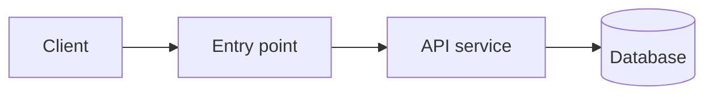

# Output Template

Fill every section. Keep the whole document to roughly 2-3 pages. Replace the
bracketed hints. Use only generic component names.

---

# Architecture Draft: <system name>

> **Status: Initial draft.** This is a first-pass structure for discussion. It is not
> a complete or validated architecture. Technology selection, detailed security,
> cost analysis, and operations are out of scope.

## 1. Purpose and Scope
<2-3 sentences: what the system does and for whom. Then the 3-5 core use cases.>

## 2. Inputs
| Item | Value | Source |
|---|---|---|
| Scale now / 12-24 months | | [given] / [assumed] |
| Peak vs average | | |
| Read:write ratio | | |
| Data size and growth | | |
| Response-time target | | |
| Downtime tolerance | | |
| Correctness-critical operations | | |
| Hard constraints | | |
| Stack constraints as given (if any) | | [given] |

## 3. Rough Sizing
<One line per figure with its arithmetic, each tagged [derived].
End with: load label (Small / Moderate / Large) and the number the design is most sensitive to.>

## 4. Architecture Overview
<Two or three sentences on the overall shape and why (e.g. "single deployable unit, because load is Small").>

<Replace with the real structure. Generic labels only.>

| Component | Role in this system | Justified by |
|---|---|---|
| | | <input or sizing figure> |

## 5. Key Flows
<2-3 flows maximum: the most important or riskiest use cases. Numbered steps, noting
sync vs async hand-offs and where data is durably written.>

## 6. Data and Consistency
- Main data groups and which component owns each.
- Which operations need strong correctness (and how the structure protects them).
- Which data can be eventually consistent or cached.

## 7. How the Traffic Pattern Is Handled
<Map each pattern (peak, spikes, read-heavy, slow work) to the structural response and
the component involved. State what happens when load exceeds the sizing.>

## 8. Risks and Trade-offs
<3-5 bullets: what this shape is weak at, and what would force a redesign.>

## 9. Assumptions and Open Questions
| # | Assumption / question | Why it matters | Who can answer |
|---|---|---|---|
<Every [assumed] item from Section 2 must appear here.>

## 10. Not Covered (next steps)
- Technology and vendor selection
- Detailed security and compliance design
- Cost estimation
- Deployment, operations, and disaster recovery
- Detailed data model and API contracts
- Formal decision records for the choices above
