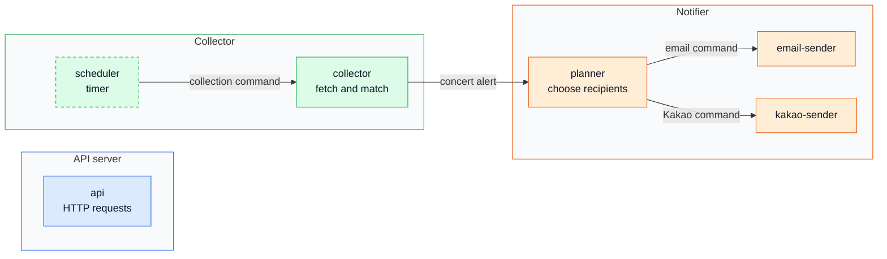

# Split deployable units by trigger and provider into three services grouped by data ownership

## Context and Problem Statement

The system does three kinds of work with different shapes: interactive requests (<1 s target, >90% reads), slow collection from external sources that can hang or fail, and notification bursts (5–10x average) through email and Kakao providers that fail independently. Inside each, work is also started differently: by an HTTP request, a timer, or a queue message.

How is the system cut into deployable units, and which units own which data?

A **unit** is something deployed and scaled on its own. A **service** is a group of units that own a set of data together. Code organization inside a unit is a coding choice and is not part of this decision.

## Considered Options

* One unit (monolith)
* One unit with enforced module boundaries (modular monolith)
* Three units, one per workload (API server, collector, notifier)
* Units split by trigger and provider, grouped into three services
* A unit per source or per channel instance

## Decision Outcome

Chosen option: "Units split by trigger and provider, grouped into three services". Work that differs in load, failure behavior, trigger, or provider gets its own unit, so a hung fetch, a slow provider, or a notification burst cannot hold up anything else. Units that share data and transactions stay together in one service.

Rules:

1. Separate units where load shape, failure domain, trigger, or provider differ.
2. Units that share data belong to one service. A service is the only writer of its data and the only one that changes its schema.
3. Units hand work to each other with asynchronous messages, never with direct calls. The mechanism is decided elsewhere.

### Units (snapshot)

Snapshot as of 2026-11-07, for explanation only. The rules above are the decision; the unit list changes as roles change. data-model.md is authoritative for entities.

| Service | Unit | Started by | Role | Why separate |
|---|---|---|---|---|
| API server | `api` | HTTP request | Auth, follows, preferences, lists, search | Interactive; must not compete with background work |
| Collector | `scheduler` | Timer | Commit due source-check jobs | Different trigger from collection. Conditional |
| Collector | `collector` | Collection message | Fetch, extract, match concerts, record alerts | Slow external I/O that can hang or fail |
| Notifier | `planner` | Alert message | Choose recipients, create intents | Database work; no provider calls |
| Notifier | `email-sender` | Email message | Submit email, record outcome | Own provider limits, credentials, failures |
| Notifier | `kakao-sender` | Kakao message | Submit Kakao message, record outcome | Own provider limits, credentials, failures |
| Collector, notifier | `relay` | Timer or after commit | Publish outgoing messages | Only if an outbox is adopted. Conditional |

Data owned by each service:

* **API server:** users, preferences, follows, likes, artist catalog (assumed to be managed on the user-facing side).
* **Collector:** concerts, concert history and evidence, alerts, collection jobs.
* **Notifier:** notification intents.

Solid arrows are asynchronous hand-offs. The dashed box may not be needed. If an outbox is adopted, a relay unit publishes each hand-off.

### Consequences

* Good, because load and failure stay contained: a stuck fetch, a slow provider, or a notification burst cannot starve interactive requests or other channels.
* Good, because units deploy and change independently, and ownership makes responsibilities clear.
* Bad, because there are more units to build, configure, and observe. For one developer the gain is isolation, not team autonomy.
* Bad, because services read each other's data, and the API server and collector depend on each other's data (concert lists vs artist catalog). This is a boundary smell to watch.
* Bad, because a change that spans services needs a coordinated rollout, and the unit list will change.

## Pros and Cons of the Options

| Option | Good | Bad |
|---|---|---|
| One unit | Simplest to build and deploy | Everything shares resources and fails together; any change redeploys all |
| Modular monolith | Module boundaries with one deployable; the strongest alternative | Still deployed, scaled, and failing together: a slow collection run or a notification burst competes with requests |
| Three units, one per workload | Isolates the three workloads with few units | Planner and senders share a unit: a slow provider delays recipient planning, and channels cannot be limited separately |
| Split by trigger and provider, three services | Isolates where load, trigger, or provider differ; ownership stays coarse | More units to run |
| A unit per source or channel instance | Finest isolation | Out of proportion for <1,000 users |
