# Use one shared database with single-owner tables and explicitly permitted cross-service reads

## Context and Problem Statement

The system has three services (API server, collector, notifier), each owning its data. They still need each other's data: concert lists need follows and concerts together, and choosing recipients needs follows, preferences, and concert changes.

Should all services use one database, or should each have its own?

## Considered Options

* One shared database, with single-owner tables and a list of permitted cross-service reads
* One database per service, with copies of shared data kept in sync by events
* One database per service, with synchronous calls to the owner for shared data
* Hybrid: shared database for data that several services use, private databases for the rest

## Decision Outcome

Chosen option: "One shared database, with single-owner tables and a list of permitted cross-service reads". 6 of the 8 data groups below (10 of the 17 entities behind them) are read by a service other than their owner, including the data behind the main read path and behind the choice of who gets a notification. Separate databases would turn each of those reads into a replication flow or a runtime dependency, and none of the benefits of separation is needed at this scale.

### Which data is shared (snapshot)

Snapshot as of 2026-11-07, for explanation only. data-model.md is authoritative for entities. Dashed boxes are proposed entities that are not in data-model.md yet. A dotted arrow means "reads data owned by the target". Collection jobs and notification intents are private to their service.

```mermaid
flowchart LR
    subgraph API["API server"]
        A1["Users and preferences<br/>User, NotificationSubscription,<br/>ArtistSubscriptionPreferences"]
        A2["Follows and likes<br/>UserFollowedArtist,<br/>UserLikeEvent"]
        A3["Artist catalog<br/>Artist, ArtistSNS"]
    end
    subgraph COL["Collector"]
        C1["Concerts<br/>Event, EventArtist, Venue"]
        C2["Concert history<br/>EventRevision, EventEvidence,<br/>EventSourceRef"]
        C3["Alerts<br/>AlertEvent"]
        C4["Collection jobs<br/>Source, SourceCheckJob"]
    end
    subgraph NOT["Notifier"]
        N1["Notification intents<br/>NotificationIntent"]
    end

    API -.->|"concert lists, search"| COL
    COL -.->|"match artists"| API
    NOT -.->|"recipients, opt-in,<br/>contact details, artist names"| API
    NOT -.->|"what changed,<br/>message content"| COL

    classDef api fill:#dbeafe,stroke:#2563eb,color:#0f172a
    classDef col fill:#dcfce7,stroke:#16a34a,color:#0f172a
    classDef notf fill:#ffedd5,stroke:#ea580c,color:#0f172a
    classDef proposed stroke-dasharray:5 4
    class A1,A2,A3 api
    class C1,C2,C3,C4 col
    class N1 notf
    class C2,C3,C4,N1 proposed
    style API fill:#f8fafc,stroke:#2563eb
    style COL fill:#f8fafc,stroke:#16a34a
    style NOT fill:#f8fafc,stroke:#ea580c
```

### What separate databases would cost

Each owner-to-reader pair would need its own flow.

| Flow (owner → reader) | Shared data | Cost |
|---|---|---|
| Collector → API server | Event, EventArtist, Venue | The main read path (followed artists' concerts, >90% of traffic) joins follows with a copy, so new concerts appear late. UserLikeEvent → Event cannot be a foreign key. |
| API server → Collector | Artist | A new artist cannot be matched until the copy catches up. EventArtist → Artist cannot be a foreign key. Renames and merges must propagate. |
| API server → Notifier | User, UserFollowedArtist, NotificationSubscription, ArtistSubscriptionPreferences | Recipients are chosen from a copy, so a user who just unfollowed or opted out can still get a notification. Email addresses are duplicated, and account deletion must propagate. |
| API server → Notifier | Artist | Artist names for rendering need a copy. |
| Collector → Notifier | AlertEvent, EventRevision, Event, EventArtist, Venue | Rendering needs the revision content: another copy, or a larger message. |

That is five new flows. Each needs a publisher on the owner side, an idempotent consumer on the reader side, a version check so an older update cannot overwrite a newer one, and a way to resync when a copy drifts. Queue payloads carry only references such as `user_id`; that works because the notifier can resolve user data from storage. With separate databases it would need a copy of that data or a call to the API server.

Synchronous calls avoid copies but add runtime coupling: the API path would depend on a collector busy fetching sources, recipient planning would call the API server once per follower, and no notification could be sent while the API server is down.

### Rules

1. All three services use one shared database.
2. Each service has its own schema (`api`, `collector`, `notifier`) and its own database role, with write access only to the tables its service owns.
3. Cross-service reads are limited to an explicit, documented list of tables, kept alongside data-model.md. At the time of this ADR the list is the dotted arrows above. Each is granted as read-only access to exactly those tables, or to views over them.
4. A change to a table that another service reads uses expand/contract (add, migrate, then remove), so services can deploy in any order.
5. Each service connects with a small connection limit of its own.

### Consequences

* Good, because there are no replication flows: reads are queries, joins and foreign keys work across owners, and recipients come from current follows and preferences.
* Good, because personal data is stored once, and if a service is split out later, the read list is the exact list of copies to create.
* Bad, because services are coupled through table schemas (rules 3 and 4 limit this) and share one failure and capacity domain: a bad query or outage affects all three.
* Bad, because ownership is enforced by roles and schemas, not physical separation, so it needs tests and discipline.
* Bad, because migrations go through one pipeline, and storage cannot scale per service.

## Pros and Cons of the Options

| Option | Good | Bad |
|---|---|---|
| One shared database | No replication; cross-owner joins and foreign keys; recipients stay current | Schema coupling and a shared failure domain |
| Per-service databases with events | Independent schemas; an outage hits one service. The notifier could keep sending while the API database is down, which is not needed: minutes of downtime are acceptable and queued work resumes after recovery | Five replication flows, lag with user-visible effects, duplicated personal data, no cross-service foreign keys or joins |
| Per-service databases with synchronous calls | No copies to sync | Runtime coupling, chatty recipient planning, sending that depends on the API server being up |
| Hybrid | Private data stays out of the shared database | The private data is small, and the collector commits concert, revision, evidence, and alert rows in one transaction, so they must stay together; it saves nothing and adds a database |
