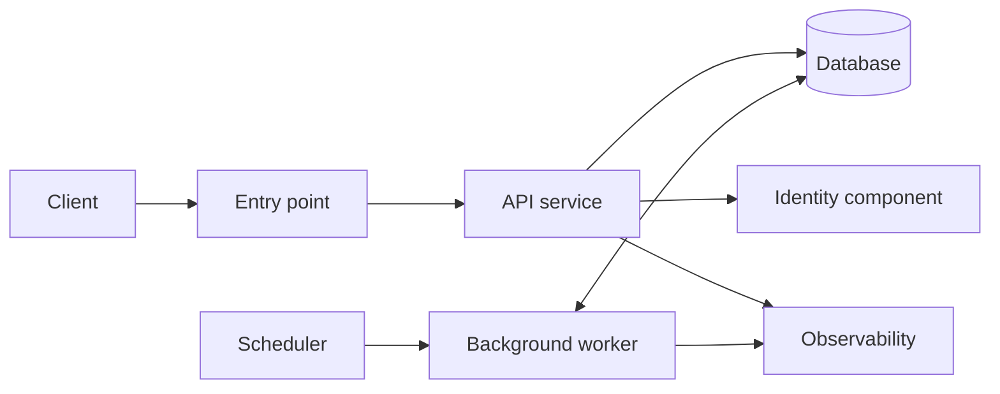

# Architecture Draft: Concert Discovery and Follower Alerts

> **Historical draft:** Resolved decisions are recorded in [Architecture Design](architecture-design.md), which supersedes this draft's open questions and conflicting proposals.

> **Status: Initial draft.** This is a first-pass structure for discussion, not a complete or validated architecture. Technology selection, detailed security, cost analysis, and operational design are out of scope.

## 1. Purpose and Scope

Regularly inspect configured artist announcement sources, identify concerts new to the system, and alert followers who requested notifications. Users can view concerts aggregated across followed artists and search artists or concerts. Collection and messaging run in the background; interactive requests have a separate response-time target.

Inputs: [architecture-input.md](architecture-input.md) and its explicitly referenced [data model](../data-model/data-model.md). Example collection frequency in the input is illustrative, not a fixed schedule.

## 2. Inputs

| Item | Value | Source |
|---|---|---|
| Scale now / future | Fewer than 1,000 users now and in 12–24 months | [given] |
| Peak vs average | 5–10×, concentrated after alerts | [given] |
| Read/write mix | More than 90% reads; background work also writes | [given] |
| Data | Users, artists, source links, venues, concerts, participation, likes, follows, notification preferences | [given], referenced model |
| Growth | Below 10 GB/year; current stored volume unspecified | [given] |
| Large files / retention | Unknown; no binary-storage or retention policy selected | [assumed], explicitly unknown |
| Response time | Below 1 second for interactive actions; collection and messaging latency not critical | [given] |
| Downtime tolerance | Minutes acceptable | [given] |
| Correctness | Exactly 1 message per new followed concert, no omissions or duplicates; email, messaging, or both selectable | [given]; channel interpretation unresolved |
| Callers / geography | Mobile web 80%, desktop web 20%; mostly Japan and Korea | [given] |
| Background work | Periodic source collection and notification delivery | [given] |
| Tenancy / hard constraints | Single tenant; no additional hard constraints supplied | [assumed] |
| Stack constraints as given | User-facing interface fixed as a Spring Boot API server; requested channels include email and Kakao messages | [given]; recorded only, not evaluated |

## 3. Rough Sizing

Let A be daily active users and R be interactive requests per active user per day. Both are unknown; a user count alone does not determine throughput.

- Average requests/second = A × R / 86,400 seconds per day [derived, unit conversion]; numeric result remains open.
- Peak requests/second P = average requests/second × (5–10) [derived from given peak factor].
- If the stated mix applies to interactive requests, peak reads > 0.90P and peak writes < 0.10P [derived from given read share]; background writes require separate measurement.
- Annual additions G < 10 GB/year [given]; daily average additions = G / 365 days per year < approximately 0.028 GB/day [derived].
- After 2 years [derived planning horizon from given upper horizon], additional retained data < 20 GB [derived: annual bound × horizon], conditional on unchanged growth and retaining all additions. Total = current volume + retained additions; current volume is unknown.
- Per-concert delivery work = distinct eligible followers × enabled channels per follower [derived]; at most 2 channels per follower [derived from given channel choices], hence fewer than 2,000 delivery intents [derived from user bound], conditional on interpreting the rule per channel.

**Load label: provisionally Small.** User scale and data growth support a simple starting structure, but request throughput and source-fetch volume cannot yet be classified numerically. The most sensitive missing sizing number is peak interactive requests/second following an alert; source count and collection cost separately determine background capacity.

## 4. Architecture Overview

Start with an API service and a database, with a scheduler and background worker as internal modules of the same deployable unit. Persist pending work in the database rather than introducing a separate message queue. Bound worker concurrency so slow collection and delivery cannot exhaust interactive capacity. This is a structural proposal, subject to throughput and recovery validation.

Source retrieval and outbound delivery occur inside the background worker; external sources and delivery dependencies are described in the flows rather than represented as additional components.

| Component | Role and required characteristics | Justified by |
|---|---|---|
| Client | Mobile and desktop web access | Given callers |
| Entry point | Expose and route interactive requests; may be integrated into API service | Public web access |
| API service | Authenticated follows, preferences, concert lists and search | Given user actions and interface constraint |
| Database | Durable domain records and pending work; transactions, uniqueness, indexed queries, safe work claiming | Referenced model and no-loss/no-duplicate requirement |
| Scheduler | Initiate due source inspections; recover missed work from durable state | Periodic collection |
| Background worker | Fetch, extract, match, persist, deliver and retry with bounded concurrency | Given background work |
| Identity component | Identify users and authorize personal preferences; integrated with API service | User-specific follows and settings |
| Observability | Logs, metrics and alerts for interactive latency, collection failures, pending-work age and delivery outcomes | Service targets and correctness requirement |

## 5. Key Flows

**Interactive access — synchronous.** Client requests pass through the entry point to the API service. After identity checks, the service queries or updates the database. Concert lists deduplicate concerts involving multiple followed artists; search initially uses database queries and indexes. Preference changes commit durably before success is returned.

**Discovery — asynchronous.** The scheduler records due collection work durably. The background worker claims work with recoverable ownership, fetches configured sources and extracts candidate concerts. It resolves concert identity across sources and artists before treating a candidate as new. In a transaction, persist the concert, artist participation and pending notification-expansion work; mark source progress only when resulting work is durable. Ambiguous matches remain pending for resolution rather than causing speculative alerts. A retry resumes from durable state.

**Notifications — asynchronous.** Process pending expansion work against follows and opt-in preferences, deduplicating recipients across participating artists. Persist delivery intents with uniqueness on concert, recipient and channel, conditional on the per-channel interpretation. Mark expansion complete only with its durable intents committed. Claim each intent, send using a stable delivery key where supported, and record the outcome. Reconcile uncertain outcomes before resending; retain unresolved work for investigation. Recheck opt-outs before dispatch, with eligibility timing to be agreed.

## 6. Data and Consistency

The API service owns user settings, follows and likes; the background worker owns collection progress, extracted candidates, concert ingestion and delivery state. Both access the shared database through explicit transactional boundaries. The referenced model supplies core domain entities; collection jobs, source evidence, identity matching and delivery records are proposed additions, not existing schema claims.

Concert creation and pending notification work must commit atomically. Concurrent discoveries need shared identity rules and database uniqueness enforcement; announcement URL alone may not identify the same concert across sources. Notification expansion and intent creation must also survive interruption without losing recipients or creating duplicate intents.

Concert data must be committed before alerts are dispatched so recipients can immediately view it. Collection freshness and notification completion can lag because their latency is not critical; preferences and delivery intent uniqueness require authoritative reads and writes.

Internal uniqueness does not by itself guarantee exactly-once external receipt. If a send succeeds but its response is lost, retries can duplicate delivery unless the external channel supports deduplication or authoritative reconciliation. The given no-more/no-less requirement remains a feasibility gate, including whether delivery means channel acceptance or actual user receipt.

## 7. How the Traffic Pattern Is Handled

Keep collection and delivery outside interactive request handling. Database-backed pending work absorbs bursts and survives process restart; bounded background execution reserves capacity for the API service. Index follower-concert queries and search paths to support the read-heavy workload and post-alert peaks.

When capacity is exceeded, background backlog grows durably and observability exposes its age. Protect interactive capacity by limiting background concurrency; retry transient failures without dropping work. Persist permanent failures for resolution. If measured shared-resource contention prevents the response target, separate background execution; consider a message queue, cache or search index only when measurements justify each component.

Minutes of acceptable downtime require recovery and restoration validation. The proposed shared deployment has a shared failure boundary; this draft does not establish that its restart or database recovery time meets the target.

## 8. Risks and Trade-offs

- Extraction accuracy, source access restrictions and cross-source identity matching can cause missed or duplicate concerts; fixtures and source-specific validation are needed later.
- Exactly-once external receipt may be unattainable for a channel without deduplication and reconciliation; channel capability must be established before claiming correctness.
- Shared API and worker resources simplify the structure but can increase interactive latency during collection or notification bursts.
- User count does not bound source volume or request rate. Larger measured throughput, expensive search or slow recovery could require a different deployment shape.
- Unknown retention and binary-content needs limit storage sizing; source evidence and delivery history must fit the stated growth budget or revise it.

## 9. Assumptions and Open Questions

| Assumption / question | Why it matters | Who can answer |
|---|---|---|
| [assumed] Binary-content handling unspecified; no dedicated storage selected | Determine whether source pages or media must be retained and their volume | Product owner |
| [assumed] Retention unspecified | Set retention for domain data, evidence, jobs and delivery history | Product owner |
| [assumed] Single tenant; no additional hard constraints supplied | Confirm account isolation, budget and other restrictions | Product owner |
| Daily active users, requests per user, and peak request rate? | Complete numerical throughput sizing and capacity checks | Product owner / workload measurement |
| Artist/source counts, fetch cost, exact schedule and required freshness? | Size collection capacity; the input's daily schedule is only an example | Product owner / source investigation |
| Does exactly 1 message [given] mean per enabled channel, or across all channels? What counts as receipt? | Resolve apparent tension with selecting both channels and validate feasibility | Product owner / delivery-channel investigation |
| What makes concerts identical across announcements, and how are edits or newly added artists handled? | Define ingestion uniqueness and which changes trigger alerts | Product owner |
| Are recipients selected at discovery or dispatch, and how should intervening preference changes behave? | Define recipient correctness and opt-out behavior | Product owner |
| Current database size; does the growth bound include operational records? | Complete total-storage sizing | Product owner |
| Precise outage and recovery objectives; acceptable data loss? Placement for Japan and Korea? | Validate recovery and latency without inventing targets | Product owner / operational validation |

## 10. Not Covered (next steps)

Technology and vendor selection; detailed security and compliance; cost estimates; deployment, operations and disaster recovery; detailed schema and API contracts; extraction and matching algorithms; delivery-channel capability validation; performance validation; formal decision records.
